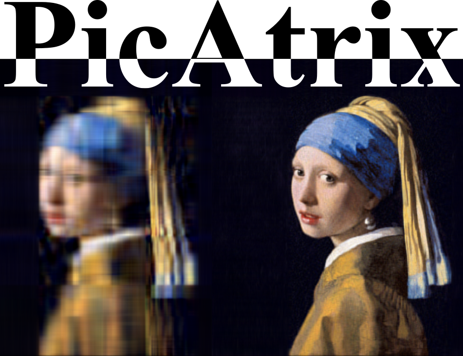

# Linear Algebra through Images

<p align="center">
  
</p>

An interactive introduction to linear algebra using image manipulation. Each
notebook builds a visual intuition for a linear algebra idea by applying it to
images with Julia.

## Repository layout

```text
.
├── images/       # Images used as notebook inputs
├── notebooks/    # Numbered Jupyter notebooks with Julia kernels
├── Project.toml  # Shared Julia environment
└── Manifest.toml # Resolved dependency versions
```

## Getting started

Requirements: Julia 1.12 or later, JupyterLab (or another Jupyter frontend),
and the IJulia kernel.

From the repository root, instantiate the Julia environment and register its
kernel:

```sh
julia --project=. -e 'using Pkg; Pkg.instantiate(); using IJulia; IJulia.installkernel("Julia", "--project=$(pwd())")'
```

Then open JupyterLab from the repository root:

```sh
jupyter lab
```

Open a notebook in `notebooks/` and select the **Julia** kernel. The notebooks
use paths relative to their own location to
load images from `images/`.

## Image sources

The notebook images in `images/` were obtained from Wikimedia Commons. Please
retain the source page, creator, and license information for each image when
redistributing this project; add those details alongside the images as they
are verified. `logo.png` is the logo for this project.

## Notebook sequence

1. [00 — Getting started](notebooks/00_getting_started.ipynb): load an image
   and inspect its array dimensions.
2. [01 — Matrix transformations](notebooks/01_matrix_transformations.ipynb):
   apply scaling, rotation, shearing, and compositions to an image.
3. [02 — Permutation matrices](notebooks/02_permutation_matrices.ipynb):
   rearrange matrix rows and columns, image strips, and pixel blocks.
4. [03 — Fourier transform](notebooks/03_fourier_transform.ipynb): compare
   spatial and frequency representations, then remove low or high frequencies.
5. [04 — Convolution as a linear operator](notebooks/04_convolution_as_linear_operator.ipynb):
   connect sparse Toeplitz matrices to image blur, sharpening, edge detection,
   and Laplacian filters.
6. [05 — Low-rank approximation](notebooks/05_low_rank_approximation.ipynb):
   use SVD and the Eckart–Young theorem to compare compressed image
   reconstructions at different ranks.
7. [06 — Randomized linear algebra](notebooks/06_randomized_linear_algebra.ipynb):
   approximate an image SVD with random projections and compare accuracy and
   runtime with the exact SVD.
8. [07 — QR decomposition](notebooks/07_qr_decomposition.ipynb): construct
   orthogonal bases and compare plain QR, column-pivoted QR, and SVD image
   approximations.
9. [08 — Sparse representation and dictionary learning](notebooks/08_sparse_representation_dictionary_learning.ipynb):
   encode image patches with an overcomplete dictionary and compare sparsity,
   reconstruction quality, and storage.
10. [09 — Matrix completion](notebooks/09_matrix_completion.ipynb): hide an
    image region and estimate its pixels with an iterative low-rank model.

Notebook outputs are kept empty in the starter notebook. Before committing
executed notebooks, clear outputs when they are not needed so diffs remain
readable.
